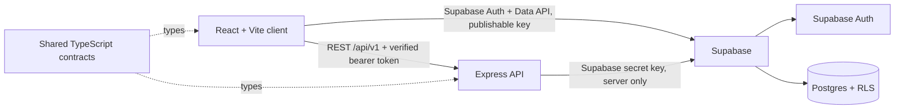

# PrepForge

PrepForge is a career-readiness workspace for students, graduates, and job seekers. The product brings interview practice, coding challenges, HR preparation, resume building, mock interviews, and progress tracking into one focused experience.

The sole application is the TypeScript/Supabase application. The previous Django/Python application and its runtime/deployment configuration have been removed.

PrepForge uses **Supabase Auth and Supabase Postgres**, not MongoDB:

```text
client/             React 18, TypeScript, Vite, Tailwind, React Router, TanStack Query
server/             Express 5, TypeScript, Zod, Supabase Auth token verification
packages/shared/    Shared TypeScript contracts and database types
supabase/           Supabase local configuration and SQL migrations
.vscode/mcp.json    Supabase MCP server configuration for VS Code
```

## Architecture



## Connect a Supabase project

1. In VS Code, open **MCP: List Servers** and authenticate the `supabase` server with your Supabase account. The repository config is `.vscode/mcp.json`; the official endpoint is `https://mcp.supabase.com/mcp`, scoped to project `vyjxuggsxnlrcihhpicm` and the database/documentation tools. After OAuth completes, reload the VS Code window so Supabase tools become available.
2. The project URL supplied for PrepForge is `https://vyjxuggsxnlrcihhpicm.supabase.co`. Do not commit credentials or paste a secret/service-role key into the client.
3. Add the project URL and **publishable** key from that project's dashboard to the root `.env`:

   ```dotenv
   VITE_SUPABASE_URL=https://your-project-ref.supabase.co
   VITE_SUPABASE_PUBLISHABLE_KEY=sb_publishable_...
   SUPABASE_URL=https://your-project-ref.supabase.co
   SUPABASE_SECRET_KEY=sb_secret_...
   ```

   `VITE_` settings are public and bundled into the browser. The `SUPABASE_SECRET_KEY` is server-only and bypasses RLS; keep it private and never prefix it with `VITE_`.

4. Apply the profile schema migration to that project. After linking the CLI to the chosen project, run:

   ```powershell
   npx supabase link --project-ref your-project-ref
   npx supabase db push
   ```

   The migration creates `public.user_profiles`, enables RLS, and allows each authenticated user to read/update only their own profile. Users cannot write their own `role`; admin roles must be assigned through a trusted Supabase dashboard/administrative process.

   You may instead review and run [the SQL migration](./supabase/migrations/20261023104559_prepforge_profiles.sql) in the Supabase SQL Editor.

5. In Supabase Auth settings, configure the site's URL and allowed redirect URLs for `http://localhost:5173` during local development and for your deployed site in production.

The question-practice schema is in [the question practice migration](./supabase/migrations/20261023112537_question_practice.sql). It adds topics, questions, attempts, answers, bookmarks, and the persisted text-size preference. RLS is enabled on every new table. The API accesses content and user-owned attempt data server-side after bearer-token verification; the secret key stays in the API.

The question bank migration [seeds the initial practice questions](./supabase/migrations/20261023150436_seed_practice_question_bank.sql) on hosted projects when you run `npx supabase db push`. `supabase/seed.sql` keeps local `supabase db reset` environments in sync. The current 35-question bank is a starting set, not the full requested 100+ questions / 30 HR questions; company-tagged questions have not been added yet, so leave the company filter blank to practice with the seeded bank.

## Run locally

Requirements: Node.js 22.13+, npm 10+, and a Supabase project (hosted or local).

1. Install dependencies:

   ```powershell
   npm install
   ```

2. Keep any existing root `.env` file intact. Add the four Supabase variables shown above to it. `.env.example` documents the values without containing real credentials.

3. Start the API and frontend:

   ```powershell
   npm run dev
   ```

   Open <http://localhost:5173>. The API health check is at <http://localhost:4000/api/v1/health>.

The landing page and API health check work without server-side Supabase credentials. Signup, login, onboarding, profile storage, and authenticated practice routes require a valid project URL and keys in `.env`, plus all migrations applied to that Supabase project. When `SUPABASE_SECRET_KEY` is missing, the API starts in public/health-only mode and returns an explicit `503` for authenticated routes rather than crashing. Supabase handles password hashing, sessions, token refresh, and email confirmation. If email confirmation is enabled, the user confirms the email before signing in.

### Local Supabase option

The CLI config is in `supabase/config.toml`. This workspace uses a hosted Supabase project, so Docker and local Supabase containers are not required. Link the hosted project with `npx supabase link`, push migrations with `npx supabase db push`, and use the project URL and keys printed in your Supabase dashboard.

## API foundation

The Express API is for server-only features and verifies incoming Supabase bearer tokens against Supabase Auth. User-owned profile reads and writes use the Supabase Data API with the user's session, so database row-level security applies.

| Method | Endpoint | Purpose |
| --- | --- | --- |
| GET | `/api/v1/health` | Service health |
| GET | `/api/v1/session` | Validate bearer token and return the signed-in user's role |
| GET | `/api/v1/practice/topics` | List practice topics |
| GET | `/api/v1/practice/questions` | Filter active questions by topic, difficulty, and company |
| POST | `/api/v1/practice/attempts` | Start a practice session or timed test |
| GET | `/api/v1/practice/attempts/resume` | Resume the latest unfinished session |
| GET | `/api/v1/practice/attempts/:id` | Load an owned attempt without exposing answers |
| PUT | `/api/v1/practice/attempts/:id/answers` | Save answer, flag, and time spent |
| POST | `/api/v1/practice/attempts/:id/complete` | Score and return results/review |
| GET/PUT/DELETE | `/api/v1/practice/bookmarks` | List, create, or remove question bookmarks |

Responses use `{ "data": ... }` on success and `{ "error": { "code": "...", "message": "..." } }` on failure.

## Validate

```powershell
npm run build
npm run lint
npm test
npm audit
```

## Delivery sequence

1. **Foundation:** authentication, onboarding, design system, responsive app shell. (Implemented.)
2. **Question practice:** foundations implemented: filters, practice feedback, timed tests, resumable attempts, bookmarks, scoring, and review. Remaining: 100+ curated questions, 30 HR questions, and company-tagged content.
3. **Career tools:** coding challenges, HR answers, resume builder, dashboard, and admin content management.
4. **AI and extras:** AI mock interview and feedback behind optional server-side provider interfaces, then study plans and gamification.

## Production notes

Use separate staging and production Supabase projects, restrict allowed authentication redirects, enforce HTTPS, store the secret key only in the API hosting secret manager, and keep RLS enabled for every exposed table. Before public deployment, also add email recovery, operational monitoring, rate limits for AI/code routes, and deployment-specific security tests.

The deployment split is a static React build on Vercel and the Node.js Express API on Render, connected to Supabase. Docker is not used.
